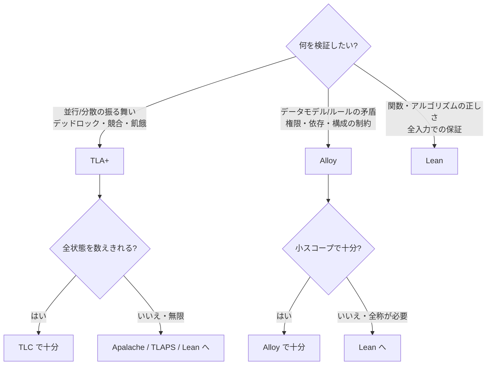

# 比較パート: Lean / TLA+ / Alloy の得意・不得意

3 コースを終えたら、**同じ題材を 3 ツールで並べて** 違いを体感します。

| # | 題材 | 解説 | 一番楽なのは? |
|---|---|---|---|
| 1 | ロック/相互排他プロトコル | [01-mutex.md](./01-mutex.md) | TLA+ |
| 2 | リスト反転(純粋関数) | [02-pure-function.md](./02-pure-function.md) | Lean |
| 3 | ファイルシステム/権限(関係モデル) | [03-relational-model.md](./03-relational-model.md) | Alloy |
| 4 | 銀行口座の送金 | [04-bank-transfer.md](./04-bank-transfer.md) | 目的次第(3 者 3 様) |

## 総括: 3 ツール比較表

| 観点 | **Lean 4** | **TLA+ (TLC)** | **Alloy 6** |
|---|---|---|---|
| **一言** | 証明するプログラミング言語 | 並行システムの設計仕様 | 軽量な構造モデリング |
| **主に書くもの** | プログラム + 定理 + 証明 | 状態遷移モデル | 構造制約 + 簡単な遷移 |
| **保証の種類** | **証明**(全入力・無限) | **網羅探索**(有限モデルの全状態) | **有界探索**(スコープ内の全世界) |
| **保証の強さ** | ◎ 最強 | ○ モデル範囲内で完全 | △〜○ スコープ内のみ |
| **自動化度** | △ 証明は人が書く(一部自動) | ◎ ボタン 1 つ | ◎ ボタン 1 つ |
| **反例** | ✗ 出ない(自分で探す) | ◎ 最短のトレース | ◎ 図(インスタンス) |
| **時間・並行性** | △ 自前でモデル化 | ◎ 中心機能(安全性/活性/公平性) | ○ Alloy 6 で可 |
| **データ構造・関係** | ○ 型・帰納型で自由に | △ 集合・関数・レコード | ◎ 関係論理 + 閉包 |
| **再帰・帰納的定義** | ◎ | △(再帰は可能、閉包は自作) | ✗ 苦手(関係で書く) |
| **整数・算術** | ◎ 任意精度 | ○ 範囲を絞れば | △ 有限ビット幅・回り込み |
| **状態爆発** | 影響を受けない(証明は別) | 受ける(主要な制約) | ソルバ次第で別の形で受ける |
| **実行可能なコード** | ◎ そのまま実行・コンパイル | ✗ モデルのみ | ✗ モデルのみ |
| **活性・公平性** | 自前 | ◎ `WF` `SF` `~>` | ○ 自前の時相式で |
| **学習コスト** | 高い(型理論的な発想・証明術) | 中(論理式で書く発想の転換) | 低〜中(関係の join に慣れる) |
| **フィードバック速度** | 中(証明が通るまで) | 速い | 最速(数秒で図) |
| **典型的な失敗** | 証明の迷子、不変条件の発見 | 状態爆発、UNCHANGED 忘れ | スコープ不足、整数の回り込み |
| **エコシステム** | Mathlib、検証済みソフトウェア | Toolbox、TLAPS、Apalache | Alloy Tools、Electrum 由来の時相論理 |

> [!NOTE]
> 評価記号は目安です。「◎」は **そのツールの主目的** に近いことを表し、他のツールが
> 「できない」わけではありません(例: TLA+ にも TLAPS という証明系があり、Alloy でも工夫すれば証明に近いことは可能)。

## 使い分けの判断軸



### 質問形式の判断

| こんなとき | 選ぶなら |
|---|---|
| 「複数のノードがこう動いたら、データが壊れない?」 | **TLA+** |
| 「この権限ルール、抜け道はない?」 | **Alloy** |
| 「この関数は、**あらゆる入力で** 仕様を満たす?」 | **Lean** |
| 実装前の設計レビューで、短時間でバグを見つけたい | **TLA+ / Alloy** |
| 暗号・コンパイラ・OS の核心部分で、絶対に間違えたくない | **Lean**(など定理証明器) |
| ルールに矛盾がないか、図で議論したい | **Alloy** |
| 公平性の仮定(スケジューラの性質)が結論に効く | **TLA+** |

## 組み合わせの現実解

3 つは競合ではなく、**抽象度と保証の強さで住み分け** ます。

```
設計の初期      Alloy   : 構造・ルールの矛盾を数分で潰す
   ↓
アルゴリズム設計  TLA+    : 並行性・分散性のバグを全探索で潰す
   ↓
核心の実装      Lean    : 最重要な部分を「全入力」で証明する
```

> [!NOTE]
> 参考(外部事例。詳細は各公式資料・論文を参照): クラウド事業者の分散システム設計での TLA+ 利用、
> アクセス制御ポリシー言語の仕様・実装を Lean で形式化・検証する取り組み、
> Alloy によるプロトコル(ネットワーク)設計の欠陥発見などが知られています。

## 学習の次の一歩

- **Lean**: 「Functional Programming in Lean」「Theorem Proving in Lean 4」「Mathematics in Lean」。Mathlib を入れて `ring` / `linarith` を使ってみる。
- **TLA+**: Learn TLA+、TLA+ Video Course。2 相コミット / Paxos / Raft の仕様を読む。TLAPS / Apalache も試す。
- **Alloy**: *Software Abstractions*(Daniel Jackson)。Alloy 6 の `var` / 時相論理の公式チュートリアル。
